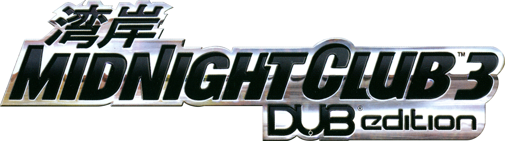
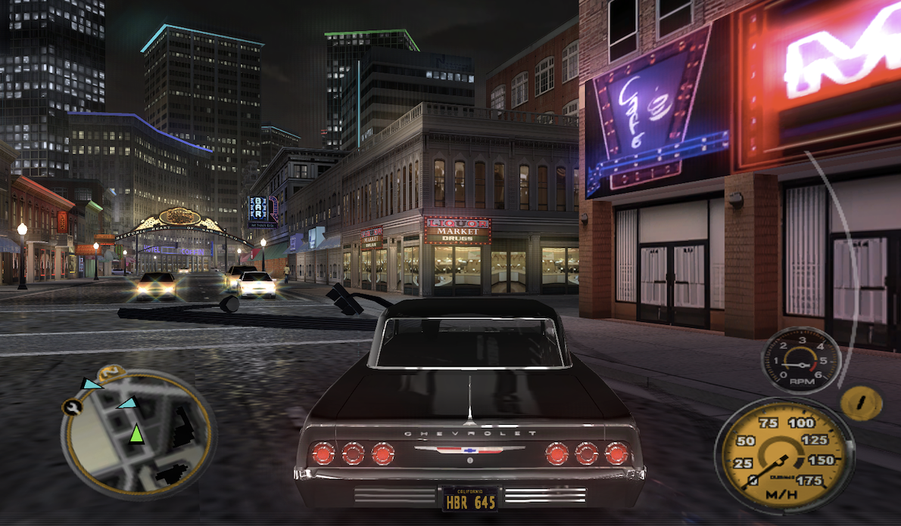

<p align="center"></p>

<p align="center">     </p>

<p align="center"></p>


The original Xbox release of *Midnight Club 3: DUB Edition*, recompiled and lifted instruction by instruction to C with [xboxrecomp](https://github.com/sp00nznet/xboxrecomp) and compiled natively for the Nintendo Switch, Linux and macOS without requirement of emulation.

Organised after the release of [nfsu2-sw](https://github.com/antoxa2584x/nfsu2-sw), whose Switch layer has been a great inspiration for this engine.

> [!WARNING]
> **No game data is included.** You need your own copy of the Xbox disc.
>

## Platforms

| Platform        | Support | Tested       | Hardware        |
| --------------- | ------- | ------------ | --------------- |
| Nintendo Switch | ✅       | 21.0.0       | V1              |
| Ubuntu Linux    | ✅       | 22.04.5      | Virtual Machine |
| Mac             | ✅       | Sequoia 15.6 | M1              |
| Windows         | ❌       | -            | -               |

## Supported Editions

| File              | Edition |
| ----------------- | ------- |
| mcdub3-nx-usa.nro | NTSC-U  |

## Installation

### Nintendo Switch

Visit the [installation](https://laureladastra.github.io/mcdub3-homepage/) page for a guided experience or manually package the folder by downloading the files from our [releases](https://github.com/laureladastra/mcdub3-nx/releases) and organise the folder according to the following hiërarchy:

```
sdmc:/switch/mcdub3-nx/
├── mcdub3-nx-usa.nro       the downloaded NRO
├── mcdub3_env.txt          optional settings                            
└── /game                   the extracted disc (not the ISO)
```

Copy the game files to the `/game` directory within this folder. Move this folder to `sdmc:/switch/mcdub3-nx/` on the Nintendo Switch. Install the .nsp to get a plug-and-play experience.

### Mac

The Mac application can be packaged and installed by following these instructions:

1. Install the Xcode command line tools (`xcode-select --install`) and
   [Homebrew](https://brew.sh).
2. Clone the repository and install the requirements for building the game:

   ```sh
   git clone https://github.com/laureladastra/mcdub3-nx.git
   cd mcdub3-nx
   make setup
   ```

3. Put your extracted disc in `game/`: `default.xbe` and all the other files
   from the disc, not the ISO. A disc extraction utility is bundled with this repo. To extract your disc you can run:

   ```sh
   make extract ISO=<file.iso>
   ```
4. Lift the game's code to C, once per disc (10 to 20 minutes):

   ```sh
   make lift
   ```

5. Build the app:

   ```sh
   make mac-app SCALE=1.5 GAME=$PWD/game
   ```

   The application file lands in `work/mac_app/Midnight Club 3.app`. Drag it to your `Applications folder`. `SCALE` sets the resolution (`1.5` = 1280x720, `2` and up for sharper). Without `GAME`, the first start opens the folder where the app wants the disc: `~/Library/Application Support/mcdub3/game/`. Settings, saves and the log live in that `mcdub3` folder too.

You can also play the game without making the app by running `make build run`

### Linux

1. Get the code and install what the build needs:

   ```sh
   git clone https://github.com/laureladastra/mcdub3-nx.git
   cd mcdub3-nx
   make setup
   ```

2. Put the extracted disc in `game/` (`make extract ISO=<file.iso>` from an ISO).
3. Lift the game's code to C, then build and play:

   ```sh
   make lift
   make build run
   ```
   
   Settings go on the command line, for example `make run RECOMP_GL_SCALE=2`. The keyboard plays as player 1 and SDL game controllers (Xbox, DualSense) are supported.

### Windows

> [!NOTE]
> Windows support is new and still being tested.

1. Download the code: **Code → Download ZIP** on this page, and unzip it (or `git clone https://github.com/laureladastra/mcdub3-nx.git`). Choose a folder without spaces in its path, for example `C:\Games\mcdub3-nx`.
2. Put the extracted disc (`default.xbe` and the rest) in its `game` folder. The disc's `.iso` works too: the installer unpacks it.
3. Double-click **`install_windows.bat`**.

The installer sets up [MSYS2](https://www.msys2.org) (the build tools, in `C:\msys64`) if it isn't there, lifts the game's code, builds it, and puts a **Midnight Club 3** shortcut on the desktop. The first run takes about an hour and needs an internet connection; after updating the code, run it again. It works on x86-64 PCs and on Windows on ARM, and writes its log to `work\logs\install_windows.log`.

The game itself lives in `work\build-windows-<arch>\dist\` (`x86_64`, or `aarch64` on Windows on ARM): `mcdub3.exe`, its DLLs and `run_mcdub3.bat`, which the shortcut starts. Settings go in **`mcdub3_env.txt`** in that same folder, one `NAME=value` per line (create it if it isn't there), for example `RECOMP_GL_SCALE=2`. The keyboard plays as player 1 and SDL game controllers are supported.

For developers: `make` and the other tools come with MSYS2 and only work in its own shell, not in Command Prompt or PowerShell. Start **MSYS2 CLANG64** from the Start menu (**MSYS2 CLANGARM64** on Windows on ARM), go to the repo and use the same commands as on Mac and Linux: `make setup`, `make lift`, `make build run`, `make run RECOMP_GL_SCALE=2`.

## Upscaling

There are two kinds, and they combine:

- **Resolution:** the game draws at a multiple of the Xbox's 720×480. `RECOMP_GL_SCALE` sets it (0.5 to 5: `1.5` = 1280×720, `2` = 1440×960, `3` and up for 1440p and 4K screens). `RECOMP_GL_UI_SCALE` (1 to 5, default `2`) does the same for menu and HUD art. Higher costs frame rate; on the Switch stay at `1.5` or below.
- **HD textures:** a texture pack replaces the game's textures with upscaled versions. You make it from your own copy of the game (below); it isn't shipped, because it's the game's art.

| Platform | Resolution | HD textures |
| --- | --- | --- |
| Nintendo Switch | `RECOMP_GL_SCALE=1.5` in `sdmc:/switch/mcdub3-nx/mcdub3_env.txt` | `hd/textures/` in `sdmc:/switch/mcdub3-nx/` (`make switch HD=1` stages it) |
| Mac app | `make mac-app SCALE=2`, other settings with `SETTINGS="RECOMP_GL_UI_SCALE=3"`; later in `~/Library/Application Support/mcdub3/mcdub3_env.txt` | `make mac-app HD=1` puts the pack inside the app; or `hd/textures/` in `~/Library/Application Support/mcdub3/` |
| Mac or Linux, from the repo | `make run RECOMP_GL_SCALE=2` | `hd/textures/` in the repo, beside `game/`: used automatically |
| Windows | `RECOMP_GL_SCALE=2` in `mcdub3_env.txt` beside `mcdub3.exe` | `hd\textures\` in the repo, beside `game\`: used automatically |

**Making a texture pack** (once, then grow it as you play more of the game):

```sh
make hd-dump RECOMP_GL_SCALE=1.5   # play the scenes you want; every texture lands in hd/dump/
make hd-tools                      # once: fetches the upscaler (Real-ESRGAN)
make hd-upscale                    # hd/dump -> hd/textures (FACTOR=2, 3 or 4)
```

Dumping works on every computer platform. The upscaler runs on a Mac or an x86-64 Linux PC only; on Windows or an ARM Linux machine, upscale on a Mac and copy `hd/textures/` over. The log says how many replacements were found: `[GL] HD pack ...: N replacement textures`. Delete `hd/` to go back to the original look.

## Saves

Profiles live where the Xbox kept them, in `UDATA/54540079/` inside the game folder: `game/` on Mac/Linux, `sdmc:/switch/mcdub3-nx/game/` on the Switch, `~/Library/Application Support/mcdub3/game/` for the Mac app. Each profile is a folder with `<name>.mc3` and `SaveMeta.xbx`. The same folder works on every platform.

**Importing a save from a real Xbox.** Profiles from an original Xbox, such as a memory unit dump (`.gsx`) from a save site, need re-signing first: the game calls them "damaged" otherwise. One command does both:

```sh
make import-save FILE=~/Downloads/midnight-club-3-dub-edition.gsx
```

It takes a `.gsx` or raw memory unit dump, an extracted save folder, a bare `.mc3`, or a PS2 save (`.max`, `.sps`, `.xps`) to check. Your saves are backed up to `work/saves-backup/` first, and an existing profile is never overwritten (`REPLACE=1` to do so). `LIST=1` only shows what is in the file. `UDATA=<folder>` installs elsewhere, for example the Mac app's folder. For the Switch, import on a computer and copy the new folder to the SD card.

An imported profile keeps its owner's settings, controller layout included. If driving or nitrous sit on the wrong buttons, pick the default layout in the game's controller options.

**PS2 saves can't be used.** The PS2 release of the same game (SLUS-21029) stores its profiles in its own layout, about a third smaller than the Xbox's and with most fields elsewhere; the PS2 *Remix* has yet another one. `make import-save` reads PS2 saves and says which version they are. Saves made by this port won't load on a real Xbox.

## Technical Overview

| Area            | State                                                                                                                                                               |
| --------------- | ------------------------------------------------------------------------------------------------------------------------------------------------------------------- |
| Lift            | 21,585 functions, 2.98 M lines of C                                                                                                                                 |
| Movies          | Bink decoded natively with FFmpeg, sound in sync, upscaled on the GPU                                                                                               |
| Audio           | XACT sound effects and the WMA music                                                                                                                                |
| Graphics        | OpenGL renderer: up to 3x resolution, square pixels in 16:9, 4:3 screens filled to widescreen, mipmaps and 16x anisotropic filtering, FXAA, sharpening, motion blur |
| Texture packs   | Optional HD replacements. Dumped from the game, upscaled (Real-ESRGAN), loaded in the background and DXT-compressed.                                                |
| Input           | Nintendo Switch controllers; on Mac/Linux the keyboard and SDL pads (DualSense, Xbox). Vibration supported.                                                         |
| Nintendo Switch | NRO and NSP forwarder                                                                                                                                               |

## ⚠️ &nbsp;Known Bugs

* loading screen can hang sometimes with a restart required
* intro menu navigation rendering is slow
* we're currently at v0.1.0, expect craches and latency

## Settings

Several settings can be configured for the runtime environment. These settings are `KEY=VALUE` pairs and can be configured by defining them in a text file and saving the file as `sdmc:/switch/mcdub3-nx/mcdub3_env.txt` on the Switch, one setting per line, with `#` starting a comment and excluding the setting from execution.

The full list, with every setting explained and commented out at its
default, is [switch/mcdub3_env.example.txt](switch/mcdub3_env.example.txt). The following settings are likely convenient to configure:


### Graphics

| Setting              | Default                    | What it does                                                                                                                                                        |
| -------------------- | -------------------------- | ------------------------------------------------------------------------------------------------------------------------------------------------------------------- |
| `RECOMP_GL_SCALE`    | `1`                        | Rendering resolution as a multiple of the Xbox's 720x480 (0.5 to 5). `1.5` gives 1280x720, the best match for a 720p screen; higher costs frame rate on the Switch. |
| `RECOMP_WIDESCREEN`  | `1`                        | Tells the game the TV is widescreen, so it renders 16:9 itself.                                                                                                     |
| `RECOMP_GL_SQUARE`   | `1`                        | Shows the widescreen picture at its true shape (square pixels).                                                                                                     |
| `RECOMP_GL_FILL`     | `1`                        | Menus and videos laid out for 4:3 fill the whole width instead of showing black side bands.                                                                         |
| `MC3_FILL_SKIP`      | `rockstar,sdlogo,mc3intro` | Movies that keep their original 4:3 framing (names from `game/video/`, without `.bik`).                                                                             |
| `RECOMP_GL_ASPECT`   | *(unset)*                  | `fill` stretches the picture to the whole screen, whatever its shape.                                                                                               |
| `RECOMP_GL_FXAA`     | `1`                        | Smooths jagged edges.                                                                                                                                               |
| `RECOMP_GL_SHARPEN`  | `0.5`                      | Sharpening strength, from 0 (off) to 1.                                                                                                                             |
| `RECOMP_GL_MIPS`     | `1`                        | Smoother textures in the distance, with less shimmering.                                                                                                            |
| `RECOMP_GL_ANISO`    | `16`                       | Keeps road textures sharp at shallow angles. 1 is off, 16 the maximum.                                                                                              |
| `RECOMP_GL_LOD_BIAS` | `-0.25`                    | Texture detail: negative is sharper, positive softer.                                                                                                               |
| `RECOMP_GL_UI_SCALE` | `2`                        | Draws menu and HUD art this many times larger: 1 (off) to 5, whole numbers.                                                                                         |

### Input and controllers

| Setting             | Default   | What it does                                                                                                                                 |
| ------------------- | --------- | -------------------------------------------------------------------------------------------------------------------------------------------- |
| `RECOMP_PAD_LAYOUT` | `label`   | Switch: `label` maps buttons by name (Switch A = Xbox A, as the on-screen prompts say). `position` maps them by position, as on an Xbox pad. |
| `RECOMP_NX_JOYCON`  | *(unset)* | Switch: `single` turns two detached Joy-Cons into one player each, held sideways.                                                            |
| `RECOMP_RUMBLE`     | `1`       | Rumble.                                                                                                                                      |
| `RECOMP_KEYBOARD`   | `1`       | Linux and macOS: the keyboard plays as player 1, alongside any connected controller.                                                         |

### Performance and logging

| Setting               | Default       | What it does                                                                                                                                                                                                               |
| --------------------- | ------------- | -------------------------------------------------------------------------------------------------------------------------------------------------------------------------------------------------------------------------- |
| `RECOMP_GL_THREAD`    | `1` on Switch | Draws on a thread of its own.                                                                                                                                                                                              |
| `RECOMP_PROG_PREWARM` | *(unset)*     | Shader compiling. By default the remembered shaders compile one per frame behind the legal screen. `boot` compiles them all at start (a few seconds of black); `0` compiles none ahead (stutters when each is first used). |
| `RECOMP_FPS_LOG`      | `0`           | Writes the frame rate to the log every 10 seconds.                                                                                                                                                                         |
| `MC3_PERF`            | *(unset)*     | Writes a performance report every N seconds: where the game waits, CPU use per thread, audio pacing.                                                                                                                       |
| `RECOMP_QUIET`        | `1` on Switch | Fewer log lines; every line costs an SD-card write.                                                                                                                                                                        |

Some settings undo a fix, for comparison only: `MC3_FENCE_FIX`,
`MC3_FLIP_PACE`, `MC3_TRAP_HOOK`, `RECOMP_TIMER_BATCH`. Others are required
and set by the game itself: `RECOMP_VBLANK`, `RECOMP_PB_EXEC`, `RECOMP_USB`,
`RECOMP_AC97_READY`, `RECOMP_NET_LINK`, `RECOMP_FLIP_VBLANK` and
`RECOMP_APU_DSP_ACK`. Leave both groups alone. The developer traces are
described in the example file and in the source.

## License

The project's own code is under the MIT license ([LICENSE](LICENSE)). The
vendored toolkit in `xboxrecomp/` keeps its own license
([xboxrecomp/LICENSE](xboxrecomp/LICENSE), third-party parts in
`xboxrecomp/LICENSES/`). No game code or data is part of this repository.

## Legal

Midnight Club is a trademark of Take-Two Interactive / Rockstar Games. This is an unofficial fan project, not affiliated with or endorsed by them, Microsoft or Nintendo.