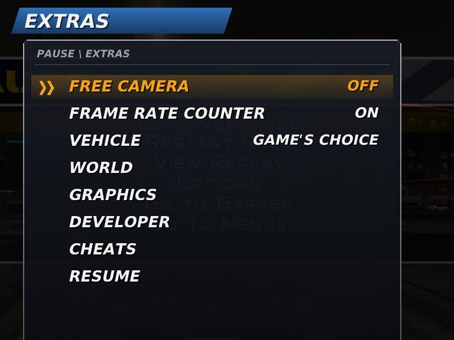
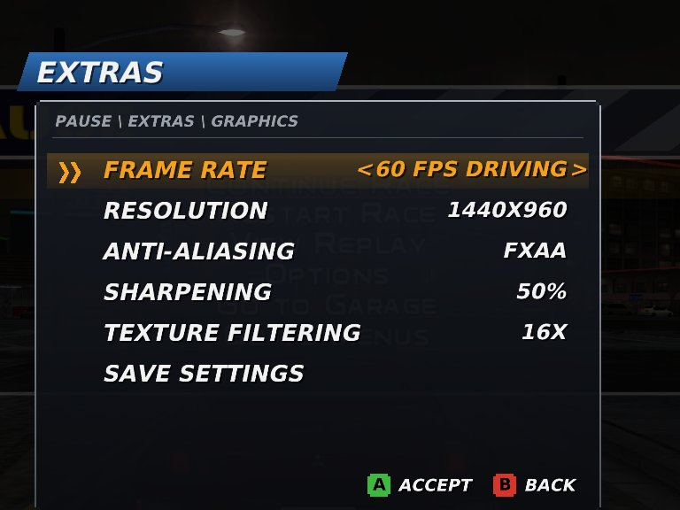
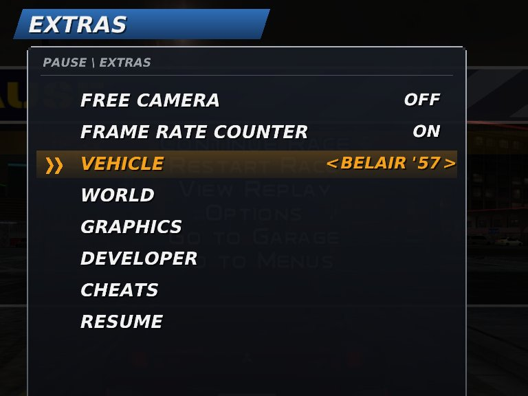
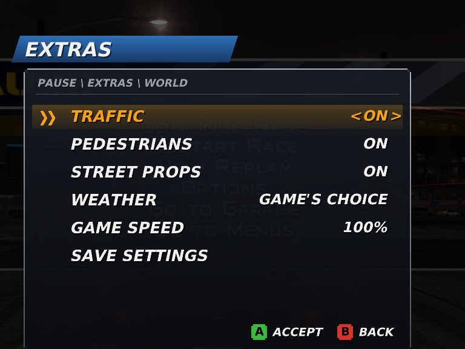
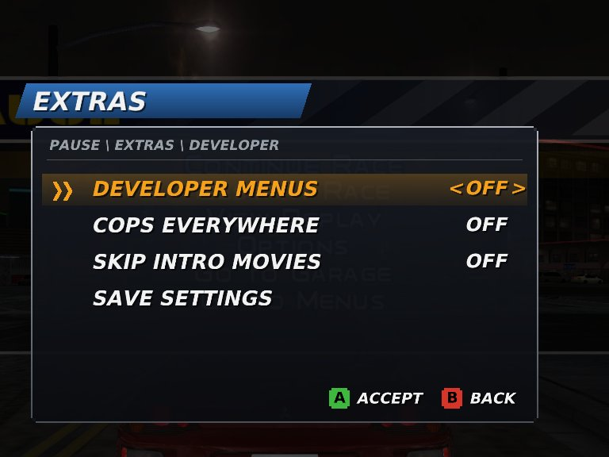
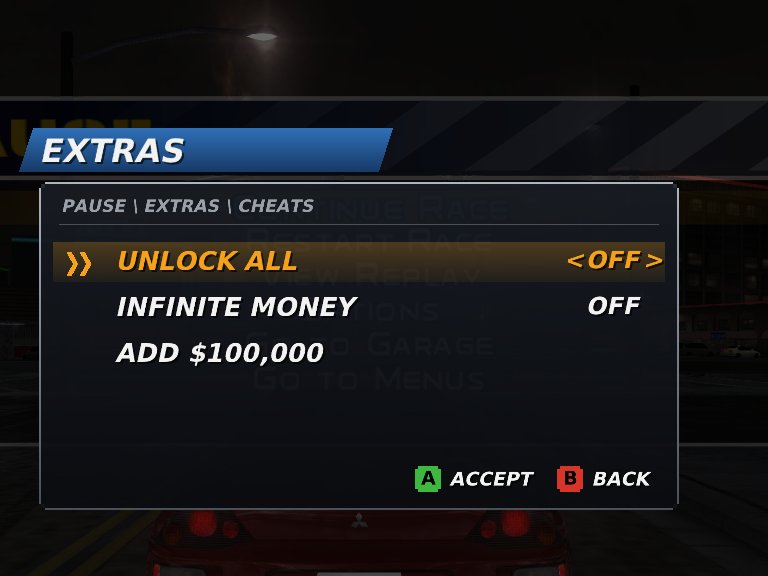
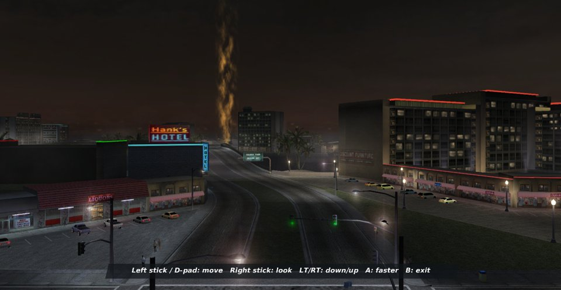
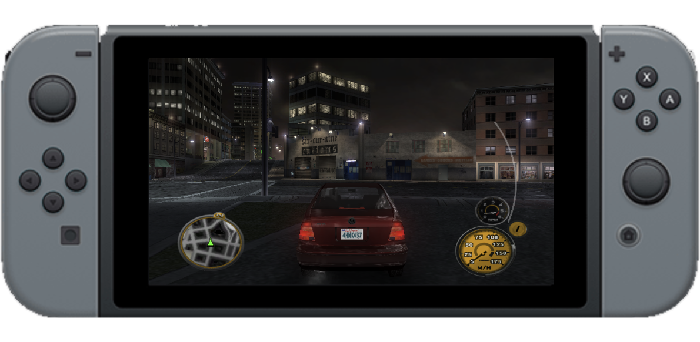

<p align="center"></p>

<p align="center">     </p>

<hr>

> [!NOTE]
> **This is a fork** of [laureladastra/mcdub3-nx](https://github.com/laureladastra/mcdub3-nx), based on its **v0.2.0** release: a **60 FPS driving mode** for the Switch, a long list of CPU optimisations, and an in-game **Extras menu** (free camera, vehicle switcher, cheats, graphics and world settings).
>
> 🤖 **Vibe-coded with Claude Opus 5.5.** Every change in this fork was written by Claude Opus 5.5 (Anthropic) in Claude Code, profiled on Linux and tested on a real Nintendo Switch (HOS 21.2, Atmosphère) that Claude drove over the network. Expect rough edges and read the code before you trust it.

## ⚡ About this fork

| | Upstream v0.2.0 | This fork |
| --- | --- | --- |
| Switch, no overclock | ~20 FPS (30 FPS cap) | ~30 FPS (30 FPS mode) |
| Switch, overclocked | 20-25 FPS (30 FPS cap) | **45-60 FPS** in the 60 FPS driving mode (dense city at the race start ~45-55, open roads 60) |
| Extras menu, free camera, vehicle switcher | - | ✅ |
| Mods folder (`mods/`) | - | ✅ |

Measured in a career race on a Switch V1. The complete list of changes is in **[CHANGELOG.md](CHANGELOG.md)**.

<p align="center">
  
  
  
</p>
<p align="center">
  
  
  
</p>
<p align="center"></p>
<p align="center"><sub>The Extras menu (R3 in the pause menu) and the free camera. Screenshots from the Linux build.</sub></p>

### No game data

Nothing from the game is in this repository: no disc files, no `default.xbe`, no lifted C (`work/gen/`, generated on your machine by `make lift`), no keys, no cover art, and no prebuilt NROs (they contain code translated from the game). The `.gitignore` keeps `game/`, `work/`, `keys/` and personal assets out. You need your own copy of the original Xbox disc.

### Which game version

*Midnight Club 3: DUB Edition* for the **original Xbox**, **NTSC-U (USA)** disc, `default.xbe` matching Redump's USA entry (title TT-121). The boot check also accepts the European (PAL) disc ([config/xbe_editions.h](config/xbe_editions.h)); this fork was only tested with the **USA** disc. Upstream's newer *Remix* support is not part of this branch.

### Setting up the game

Put **your own extracted copy** of the disc into the `game/` folder (`default.xbe` and the disc's folders, not the ISO). Then lift and build as described in the platform sections below (`make lift`, then `make build run`, or `make switch` for the Switch NRO; `make switch LTO=1 MEMFAST=1` builds the fastest one, `BWRAP=1` works without Docker or root). On the Switch the folder is `sdmc:/switch/mcdub3-nx/game/`, with the NRO beside it; turn on *Extras → Graphics → Frame Rate → 60 FPS Driving* (or `MC3_FPS60=1` in `mcdub3_env.txt`) together with your overclock profile.

### Known limits

- The free camera shows only the part of the city that is loaded around the car.
- A vehicle change in career mode applies at once through a quick garage visit (*Apply Vehicle Now*); elsewhere from the next race.

The upstream README follows.

<hr>

The original Xbox release of *Midnight Club 3: DUB Edition*, recompiled and lifted instruction by instruction to C with [xboxrecomp](https://github.com/sp00nznet/xboxrecomp) and compiled natively for the Nintendo Switch, Linux, macOS and Windows without the requirement of emulation.

Organised after the release of [nfsu2-sw](https://github.com/antoxa2584x/nfsu2-sw), whose Switch layer has been a great inspiration for this engine.

> [!WARNING]
> **No game data is included.** You need your own copy of the Xbox disc.
>

## ✨ Status

The Switch build can play towards the end until 100% career progress. Playing requires maximum overclock with the game running at 20-25 FPS of the game's maximum 30 FPS. Improvements are focused on performance.

<p align="center"></p>


<hr>

Playing on the Mac and Linux, 30 FPS is consistently achieved with 5x upscale settings (close to 4K) support. Improvements are focused on graphics and minor bug fixes.

<p align="center"></p>

> [!WARNING]
> Windows support is experimental and still being tested.

## Platforms

| Platform        | Support | Tested         | Hardware                              |
| --------------- | ------- | -------------- | ------------------------------------- |
| Nintendo Switch | ✅       | 21.0.0         | V1                                    |
| Linux           | ✅       | Ubuntu 22.04.5 | Virtual Machine                       |
| Mac             | ✅       | Sequoia 15.6   | M1                                    |
| PC              | ✅       | Windows 11     | Virtual Machine and Intel i7 Hardware |

## Supported Editions

| File              | Edition                                                 |
| ----------------- | ------------------------------------------------------- |
| mcdub3-nx-usa.nro | NTSC-U (English)                                        |
| mcdub3-nx-eur.nro | PAL (Europe: English, French, German, Spanish, Italian) |

## Installation

### Nintendo Switch

Visit the [installation](https://laureladastra.github.io/mcdub3-homepage/) page for a guided experience or manually package the folder by downloading the files from our [releases](https://github.com/laureladastra/mcdub3-nx/releases) and organise the folder according to the following hierarchy:

```
sdmc:/switch/mcdub3-nx/
├── mcdub3-nx-usa.nro       the downloaded NRO (mcdub3-nx-eur.nro for the European disc)
├── mcdub3_env.txt          optional settings                            
├── /game                   the extracted disc (not the ISO), USA or Europe
└── /game-eur               optional: a second edition's disc beside it
```

Copy the game files to the `/game` directory within this folder. Move this folder to `sdmc:/switch/mcdub3-nx/` on the Nintendo Switch. Install the .nsp to get a plug-and-play experience.

### Mac

The Mac application can be packaged and installed by following these instructions:

1. Install the Xcode command line tools (`xcode-select --install`) and
   [Homebrew](https://brew.sh).
2. Clone the repository and install the requirements for building the game:

   ```sh
   git clone https://github.com/laureladastra/mcdub3-nx.git
   cd mcdub3-nx
   make setup
   ```

3. Put your extracted disc in `game/`: `default.xbe` and all the other files
   from the disc, not the ISO. A disc extraction utility is bundled with this repo. To extract your disc you can run:

   ```sh
   make extract ISO=<file.iso>
   ```

   A second edition goes beside it in `game-<edition>/`: `make extract ISO=<file.iso> EDITION=eur` unpacks the European disc into `game-eur/`, `make mac-app GAME=$PWD/game-eur` builds the app with it, and `make run EDITION=eur` plays it from the repo.
4. Lift the game's code to C, once (10 to 20 minutes; every edition uses the same lift):

   ```sh
   make lift
   ```

5. Build the app:

   ```sh
   make mac-app GAME=$PWD/game
   ```

   The application file lands in `work/mac_app/Midnight Club 3.app`. Drag it to your `Applications folder`. By default the app renders at scale 5 (3600x2400) with menu and HUD art at 5 too; a slower Mac plays more smoothly with lower values, for example `make mac-app SCALE=1.5 UI_SCALE=2` (see [Upscaling](#upscaling)). `SETTINGS` bakes in any other setting from the [Settings](#settings) tables as a default, space-separated: `make mac-app SETTINGS="RECOMP_GL_SHARPEN=0.3 MC3_MOVIE_VOLUME=80"`. Without `GAME`, the first start opens the folder where the app wants the disc: `~/Library/Application Support/mcdub3/game/`. Settings, saves and the log live in that `mcdub3` folder too.

You can also play the game without making the app by running `make build run`.

### Linux

The game can be run locally without packaging:

1. Get the code and install what the build needs:

   ```sh
   git clone https://github.com/laureladastra/mcdub3-nx.git
   cd mcdub3-nx
   make setup
   ```

2. Put the extracted disc in `game/` (`make extract ISO=<file.iso>` from an ISO). A second edition goes in `game-<edition>/` beside it (`make extract ISO=<file.iso> EDITION=eur`) and plays with `make run EDITION=eur`.
3. Lift the game's code to C, then build and play:

   ```sh
   make lift
   make build run
   ```
   
   Settings go on the command line, for example `make run RECOMP_GL_SCALE=2`. The keyboard plays as player 1 and SDL game controllers (Xbox, DualSense) are supported.

### Windows

The game can be run locally or packaged by following these instructions:

1. Copy the code to a folder without spaces in its path (e.g. `C:\Games\mcdub3-nx`):

   ```sh
   git clone https://github.com/laureladastra/mcdub3-nx.git
   ```
2. Put your extracted disc (`default.xbe` and the rest) or `.iso` in the `game` folder. The installer will automatically unpack the .iso. A second edition goes in a `game-<edition>` folder beside it (`game-eur` for the European disc); `make build EDITION=eur` makes the game start that one.
3. Double-click the installer **`install_windows.bat`**. The installer sets up [MSYS2](https://www.msys2.org) (the build tools, in `C:\msys64`) if it doesn't exist, lifts the game's code, builds it and puts a **Midnight Club 3** shortcut on the desktop. The first run takes about an hour and requires an internet connection to install the dependencies.

The game lives in `work\build-windows-<arch>\dist\` (`x86_64`, or `aarch64` on Windows on ARM): `mcdub3.exe` and its DLLs. Start it with the desktop shortcut or by double-clicking `mcdub3.exe`. Every build makes or refreshes the shortcut. Keep the exe in that folder (it needs its DLLs and finds the disc in the repo's `game` folder). Settings go in **`mcdub3_env.txt`** in that same folder, one `NAME=value` per line, for example `RECOMP_GL_SCALE=2`, according to the specifications in [Settings](#settings). By default the game renders at scale 5 (3600x2400) with menu and HUD art at 5 too. The keyboard plays as player 1 and SDL game controllers are supported.

For developers: `make` and the other tools come with MSYS2 and only work in its own shell, not in Command Prompt or PowerShell (there, "make" is not recognised). Double-click **`tools\windows\shell.bat`**: it opens that shell in the repo folder, for x86-64 or ARM as your PC needs (by hand: `C:\msys64\msys2_shell.cmd -clang64 -here`, or `-clangarm64` on Windows on ARM). Then the same commands as on Mac and Linux: `make setup`, `make lift`, `make build run`, `make run RECOMP_GL_SCALE=2`. `make build` also takes the app defaults, like `make mac-app`: `make build SCALE=2 UI_SCALE=3 SETTINGS="RECOMP_GL_SHARPEN=0.3"`.

## Upscale Defaults

| Platform                    | Default (`SCALE` / `UI_SCALE`) | How to change it                                                                                                                                                                                            |
| --------------------------- | ------------------------------ | ----------------------------------------------------------------------------------------------------------------------------------------------------------------------------------------------------------- |
| Mac app                     | **5 / 5**                      | When building: `make mac-app SCALE=2 UI_SCALE=3`. Afterwards: `RECOMP_GL_SCALE=2` and `RECOMP_GL_UI_SCALE=3` in `~/Library/Application Support/mcdub3/mcdub3_env.txt`                                       |
| Windows                     | **5 / 5**                      | `RECOMP_GL_SCALE=2` and `RECOMP_GL_UI_SCALE=3` in `mcdub3_env.txt` beside `mcdub3.exe` (every option is listed there, commented out). Or when building, in the MSYS2 shell: `make build SCALE=2 UI_SCALE=3` |
| Mac or Linux, from the repo | 1 / 2                          | `make run RECOMP_GL_SCALE=2 RECOMP_GL_UI_SCALE=3`                                                                                                                                                           |
| Nintendo Switch             | 1 / 2                          | `RECOMP_GL_SCALE=1.5` in `sdmc:/switch/mcdub3-nx/mcdub3_env.txt`; stay at `1.5` or below there                                                                                                              |

A setting in `mcdub3_env.txt` always wins over what the app was built with.

## Saves

Profiles live where the Xbox kept them, in `UDATA/54540079/` inside the game folder: `game/` on Mac/Linux, `sdmc:/switch/mcdub3-nx/game/` on the Switch, `~/Library/Application Support/mcdub3/game/` for the Mac app. Each profile is a folder with `<name>.mc3` and `SaveMeta.xbx`. The same folder works on every platform.

**Between the Switch and a computer.** With an FTP server running on the Switch (ftpd, sphaira, ...) and both on the same network:

```sh
make save-sync-down HOST_IP=192.168.1.20   # Switch -> computer
make save-sync-up   HOST_IP=192.168.1.20   # computer -> Switch
```

Before copying, both show the direction (Switch to computer, or computer to Switch) and which profiles will be created or overwritten, and ask to confirm (`YES=1` skips the question). `HOST_IP` is the Switch's address, shown by its FTP server. The port is 21 by default; for another, add it after the IP: `HOST_IP=192.168.1.20:5000`. Profiles are added or replaced, never deleted, and the receiving side is backed up to `work/saves-backup/` first. `PROFILE=` syncs one profile, by folder or by name (`PROFILE=laurd`), `LIST=1` only shows both sides, `FTP_USER=`/`FTP_PASS=` if the server asks for a login (a server that requires encryption, FTPS, works too). The Mac app keeps its saves elsewhere: add `UDATA="$HOME/Library/Application Support/mcdub3/game/UDATA"`. On a Mac, "No route to host" while `ping` works means the app you run `make` in lacks macOS's Local Network permission. It's per app (Terminal, iTerm, VS Code, VSCodium): allow it in System Settings > Privacy & Security > Local Network, then restart that app.

**Importing a save from a real Xbox.** Profiles from an original Xbox, such as a memory unit dump (`.gsx`) from a save site, need re-signing first: the game calls them "damaged" otherwise. One command does both:

```sh
make import-save FILE=~/Downloads/midnight-club-3-dub-edition.gsx
```

It takes a `.gsx` or raw memory unit dump, an extracted save folder, a bare `.mc3`, or a PS2 save (`.max`, `.sps`, `.xps`) to check. Your saves are backed up to `work/saves-backup/` first, and an existing profile is never overwritten (`REPLACE=1` to do so). `LIST=1` only shows what is in the file. `UDATA=<folder>` installs elsewhere, for example the Mac app's folder. For the Switch, import on a computer and copy the new folder to the SD card.

An imported profile keeps its owner's settings, controller layout included. If driving or nitrous sit on the wrong buttons, pick the default layout in the game's controller options.

> [!warning]
> **PS2 saves cannot be used.**
>

The PS2 release of the same game (SLUS-21029) stores its profiles in its own layout, about a third smaller than the Xbox's and with most fields elsewhere; the PS2 *Remix* has yet another one. `make import-save` reads PS2 saves and says which version they are. Saves made by this port won't load on a real Xbox.

## Technical Overview

| Area          | State                                                                                                                                                               |
| ------------- | ------------------------------------------------------------------------------------------------------------------------------------------------------------------- |
| Lift          | 21,585 functions, 2.98 M lines of C                                                                                                                                 |
| Movies        | Bink decoded natively with FFmpeg, sound in sync, upscaled on the GPU                                                                                               |
| Audio         | XACT sound effects and the WMA music                                                                                                                                |
| Graphics      | OpenGL renderer: up to 3x resolution, square pixels in 16:9, 4:3 screens filled to widescreen, mipmaps and 16x anisotropic filtering, FXAA, sharpening, motion blur |
| Texture packs | Optional HD replacements. Dumped from the game, upscaled (Real-ESRGAN), loaded in the background and DXT-compressed.                                                |
| Input         | Nintendo Switch controllers; on Mac/Linux the keyboard and SDL pads (DualSense, Xbox). Vibration supported.                                                         |

## Extras Menu

Press the **right stick (R3)** while the game is paused to open **Extras**: a menu in the style of the game's own, available everywhere the pause menu is (**L3+R3** together opens it outside the pause menu too; `MC3_EXTRAS_COMBO=0` turns that off).

| Entry              | What it does                                                                                                                                                                                                     |
| ------------------ | ---------------------------------------------------------------------------------------------------------------------------------------------------------------------------------------------------------------- |
| Free Camera        | Fly freely through the city while the game stands still. Left stick or d-pad: move, right stick (or d-pad left/right): look, LT/RT: down/up, A: faster, L3: slower, B: back to the pause menu. The game's menus and HUD are hidden while you fly. |
| Frame Rate Counter | Frames per second and frame time in the top left corner.                                                                                                                                                        |
| Vehicle            | Drive any of the game's 69 vehicles, including the ones career never sells: the police Impalas, the police motorcycle (`KWZ COP '98`), Skully's chopper, the Monster. Takes effect at the next race or garage exit; *Game's Choice* gives your own car back. In career mode, *Apply Vehicle Now (via Garage)* does the garage visit for you: it opens the garage from the pause menu and drives out again, and you are back in the city in the new car (your progress in the current cruise is lost, as with the game's own *Go to Garage*). |
| Frame Rate         | (Graphics page) *30 FPS* as the game was made, *60 FPS Driving* (60 while the world is on screen, menus and pause stay at 30) or *60 FPS Always* (menus then run twice as fast). The game's step follows the real frame time, so driving keeps its speed at any rate between 30 and 60. Needs a fast enough console: on the Switch realistically only with overclocking. |
| World              | Traffic, pedestrians and street props on or off (fewer of them is also less work for the CPU), the weather (clear, cloudy, rain) and the game speed (slow motion: 75, 50 or 25%). From the next race or city load. |
| Developer          | Rockstar's developer switches still in the game: developer menus, police everywhere, skipping the intro movies. After a restart. |
| Graphics           | Resolution, anti-aliasing, sharpening and texture filtering. Anti-aliasing and sharpening change at once; resolution and filtering after a restart. *Save Settings* writes them to `mcdub3_env.txt`.               |
| Cheats             | Only in Career mode: **Unlock All** (cities, cars, parts, races; the game's own unlock switches), **Infinite Money** (kept at $9,999,999) and **Add $100,000**. Both switches stay on until you turn them off. |

### Developer parameters

The game still reads Rockstar's 172 developer parameters from its command line. `MC3_ARGS` in `mcdub3_env.txt` passes them, space-separated, e.g. `MC3_ARGS=-notraffic -weather=rainy`. Some useful ones: `-weather=clear|cloudy|rainy`, `-notraffic`, `-nopeds`, `-noprops`, `-forcecops`, `-devmenus`, `-skipintro`, `-nocinematics`. The log lists what was passed as `[ARGS]` lines.

## Mods

Files of the game, textures and settings can be replaced from a `mods` folder beside the `game` folder, without changing the disc or the code. The folder is read when the game starts.

```
sdmc:/switch/mcdub3-nx/mods/
├── files/                 replaces a file of the disc at the same path,
│                          e.g. files/video/rockstar.bik, files/flash/pause_x.xbck
├── packs/<name>/files/    the same, one folder per mod (later names win, files/ wins over all)
├── textures/<hash>.png    replacement textures, named like an HD pack's
├── ui/font.ttf            the font of the Extras menu
└── settings.txt           more KEY=VALUE settings, applied after mcdub3_env.txt
```

Names are matched without regard to upper or lower case, as on the Xbox. The log (`mcdub3_log.txt`) lists every replaced file as a `[MODS]` line. Textures are found by the hash of their content: `RECOMP_GL_TEX_DUMP=1` on a computer writes every texture the game uses, named by that hash, to start from.

## ⚠️ &nbsp;Known Bugs

* loading screen can hang sometimes with a restart required
* intro menu navigation rendering is slow
* we're currently at v0.1.0, expect crashes and latency

## Settings

Several settings can be configured for the runtime environment. These settings are `KEY=VALUE` pairs and can be configured by defining them in a text file and saving the file as `sdmc:/switch/mcdub3-nx/mcdub3_env.txt` on the Switch, one setting per line, with `#` starting a comment and excluding the setting from execution.

The full list, with every setting explained and commented out at its
default, is [switch/mcdub3_env.example.txt](switch/mcdub3_env.example.txt). The following settings are likely convenient to configure:


### Graphics

| Setting              | Default                         | What it does                                                                                                                                                        |
| -------------------- | ------------------------------- | ------------------------------------------------------------------------------------------------------------------------------------------------------------------- |
| `RECOMP_GL_SCALE`    | `1` (Mac and Windows apps: `5`) | Rendering resolution as a multiple of the Xbox's 720x480 (0.5 to 5). `1.5` gives 1280x720, the best match for a 720p screen; higher costs frame rate on the Switch. |
| `RECOMP_WIDESCREEN`  | `1`                             | Tells the game the TV is widescreen, so it renders 16:9 itself.                                                                                                     |
| `RECOMP_GL_SQUARE`   | `1`                             | Shows the widescreen picture at its true shape (square pixels).                                                                                                     |
| `RECOMP_GL_FILL`     | `1`                             | Menus and videos laid out for 4:3 fill the whole width instead of showing black side bands.                                                                         |
| `MC3_FILL_SKIP`      | `rockstar,sdlogo,mc3intro`      | Movies that keep their original 4:3 framing (names from `game/video/`, without `.bik`).                                                                             |
| `RECOMP_GL_ASPECT`   | *(unset)*                       | `fill` stretches the picture to the whole screen, whatever its shape.                                                                                               |
| `RECOMP_GL_FXAA`     | `1`                             | Smooths jagged edges.                                                                                                                                               |
| `RECOMP_GL_SHARPEN`  | `0.5`                           | Sharpening strength, from 0 (off) to 1.                                                                                                                             |
| `RECOMP_GL_MIPS`     | `1`                             | Smoother textures in the distance, with less shimmering.                                                                                                            |
| `RECOMP_GL_ANISO`    | `16`                            | Keeps road textures sharp at shallow angles. 1 is off, 16 the maximum.                                                                                              |
| `RECOMP_GL_LOD_BIAS` | `-0.25`                         | Texture detail: negative is sharper, positive softer.                                                                                                               |
| `RECOMP_GL_UI_SCALE` | `2` (Mac and Windows apps: `5`) | Draws menu and HUD art this many times larger: 1 (off) to 5, whole numbers.                                                                                         |

### Input and controllers

| Setting             | Default   | What it does                                                                                                                                 |
| ------------------- | --------- | -------------------------------------------------------------------------------------------------------------------------------------------- |
| `RECOMP_PAD_LAYOUT` | `label`   | Switch: `label` maps buttons by name (Switch A = Xbox A, as the on-screen prompts say). `position` maps them by position, as on an Xbox pad. |
| `RECOMP_NX_JOYCON`  | *(unset)* | Switch: `single` turns two detached Joy-Cons into one player each, held sideways.                                                            |
| `RECOMP_RUMBLE`     | `1`       | Rumble.                                                                                                                                      |
| `RECOMP_KEYBOARD`   | `1`       | Linux and macOS: the keyboard plays as player 1, alongside any connected controller.                                                         |

### Performance and logging

| Setting               | Default       | What it does                                                                                                                                                                                                               |
| --------------------- | ------------- | -------------------------------------------------------------------------------------------------------------------------------------------------------------------------------------------------------------------------- |
| `RECOMP_GL_THREAD`    | `1` on Switch | Draws on a thread of its own.                                                                                                                                                                                              |
| `RECOMP_GL_PERSIST`   | `1`           | Vertex and index data go straight into buffers mapped once, instead of mapping and unmapping them for every draw. `0` brings back the old way, for a driver that has trouble with it.                                     |
| `MC3_FPS_COUNTER`     | `0`           | Frame rate counter on screen (also in the Extras menu).                                                                                                                                                                    |
| `RECOMP_PROG_PREWARM` | *(unset)*     | Shader compiling. By default the remembered shaders compile one per frame behind the legal screen. `boot` compiles them all at start (a few seconds of black); `0` compiles none ahead (stutters when each is first used). |
| `RECOMP_FPS_LOG`      | `0`           | Writes the frame rate to the log every 10 seconds.                                                                                                                                                                         |
| `MC3_PERF`            | *(unset)*     | Writes a performance report every N seconds: where the game waits, CPU use per thread, audio pacing.                                                                                                                       |
| `RECOMP_QUIET`        | `1` on Switch | Fewer log lines; every line costs an SD-card write.                                                                                                                                                                        |

Some settings undo a fix, for comparison only: `MC3_FENCE_FIX`,
`MC3_FLIP_PACE`, `MC3_TRAP_HOOK`, `RECOMP_TIMER_BATCH`. Others are required
and set by the game itself: `RECOMP_VBLANK`, `RECOMP_PB_EXEC`, `RECOMP_USB`,
`RECOMP_AC97_READY`, `RECOMP_NET_LINK`, `RECOMP_FLIP_VBLANK` and
`RECOMP_APU_DSP_ACK`. Leave both groups alone. The developer traces are
described in the example file and in the source.

## License

The project's own code is under the MIT license ([LICENSE](LICENSE)). The
vendored toolkit in `xboxrecomp/` keeps its own license
([xboxrecomp/LICENSE](xboxrecomp/LICENSE), third-party parts in
`xboxrecomp/LICENSES/`). No game code or data is part of this repository.

## Legal

Midnight Club is a trademark of Take-Two Interactive / Rockstar Games. This is an unofficial fan project, not affiliated with or endorsed by them, Microsoft or Nintendo.